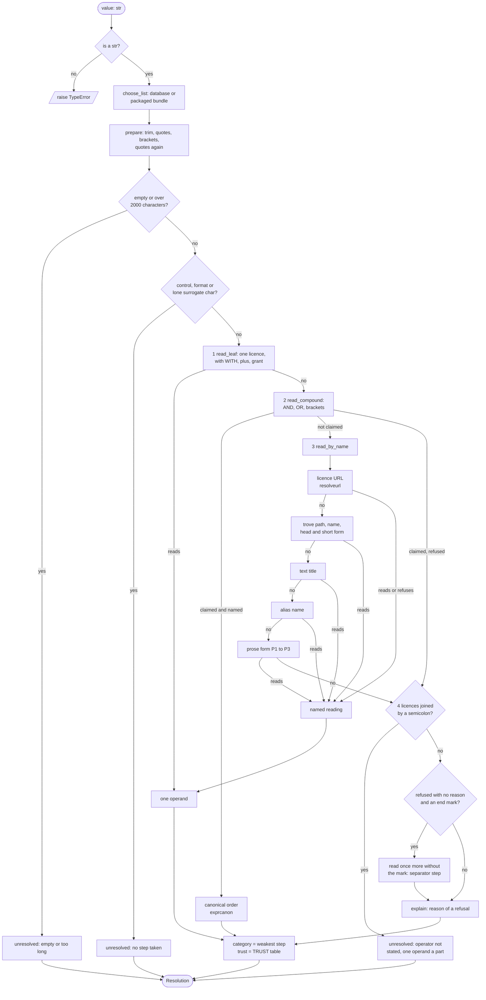
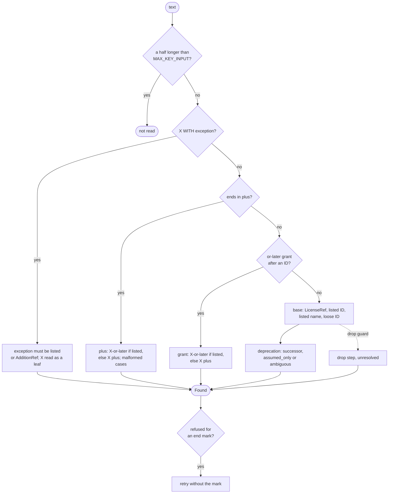

# How `resolve()` works: the flow of a declared value

This page traces what `licenseid.resolve()` does to one declared licence
value, reader by reader, in the order the readers run. It is written for a
reviewer who wants to check the design, and as source material for a paper.
It describes the code at release 0.7.2 plus PR #172 (`main` at commit
`7276ee4`), and the licence URL reader (issue #14), which the line links
below do not follow: the links point at the files of that commit and move
when the code does.

Every example below was run against that code (`resolve(value)`, with the
SPDX License List in the shipped bundle or the database). The result fields
(`expression`, `category`, `trust`, `steps`, `reason`) are those of
[the result of `resolve()`](resolve.md); this page does not repeat their
full description. How the expression part is put in order is in
[SPDX expression canonicalisation](expression-canonicalisation.md).

## Contents

- [The flowchart](#the-flowchart)
- [The same flow as a numbered list](#the-same-flow-as-a-numbered-list)
- [What each reader accepts and refuses](#what-each-reader-accepts-and-refuses)
- [Step kinds, categories and trust](#step-kinds-categories-and-trust)
- [Worked examples](#worked-examples)
- [Where the flow surprises](#where-the-flow-surprises)

## The flowchart

Rectangles are readers or gates, diamonds are decisions. "Refuse" means the
value gets `expression` of `None`, with a `reason`. The Mermaid source
renders on GitHub; the numbered list below says the same in words.



The diagram folds three details to stay readable. The list reader (step 4)
runs before a compound's refusal is returned, not after (see
[the order inside `_read_text`](#the-order-inside-_read_text)). The
"read once more" box also covers a mark inside brackets and quotes. And the
leaf reader has inner rules of its own, drawn in the next diagram.

### The leaf reader

`read_leaf` is the one reader of IDs, names, `+` and "or later". Every other
reader reduces its text and hands the reduction to it.



## The same flow as a numbered list

Each number is a place in the source. A reader stops the flow when it
reads the value, or when it refuses it with a reason.

1. **Type gate** ([`_require_text`](../src/licenseid/resolver.py#L192)). A
   value that is not a `str` raises `TypeError`. This is the one case that
   raises on the value.
2. **Choose the list** ([`choose_list`](../src/licenseid/listsource.py#L106)).
   A `db` the caller gives is read as it is. Otherwise `source="auto"` reads
   the database at the default path or the bundle in the wheel, whichever
   holds the newer List; with no database file, the bundle. The reading
   happens in one `lookup.reading()` block
   ([`resolve_with`](../src/licenseid/resolver.py#L113)).
3. **Prepare the text** ([`_prepared`](../src/licenseid/resolver.py#L301)),
   with one step for each change:
   1. control and format characters at either end come off with the white
      space beside them ([`strip_hidden`](../src/licenseid/hiddenchars.py);
      `trim`, detail `invisible characters`; sets the `separator` floor);
      a bidi control at the start, a NUL or a value of nothing else is left
      for the refusal in step 5;
   2. trim white space (`trim`);
   3. one end mark after closing quotes (`"MIT".`) comes off (`separator`),
      then quote marks round the whole value
      ([`quotes.unquote`](../src/licenseid/quotes.py#L82), `unquote`; an
      unbalanced pair sets the `separator` floor);
   4. brackets round the whole value (`brackets`,
      [`exprcanon.unbracketed`](../src/licenseid/exprcanon.py#L72));
   5. quotes again, if brackets came off (`("MIT")`).
4. **Empty or too long.** Nothing left is `unresolved` with reason `empty`;
   more than 2,000 characters
   ([`MAX_EXPRESSION_CHARS`](../src/licenseid/resolver.py#L73)) is
   `unresolved` with a reason from `resolvereason.too_long`.
5. **Character gate** ([`_refusal`](../src/licenseid/resolver.py#L349)). A
   lone surrogate, or a control or format character that is not white space
   (NUL, a zero-width space, a bidi override), refuses the whole value
   before any reader runs, with no step. The check runs on the value with
   the hidden characters at its ends left off (step 3.1), before any other
   reader, so no reader can drop such a character as a separator.
6. **The readers**
   ([`_read_text`](../src/licenseid/resolver.py#L229)), first match wins:
   1. *One licence*
      ([`read_leaf`](../src/licenseid/resolveleaf.py#L139)): `X`, `X+`,
      `X WITH Y`, a listed name, a loosely written ID, an "or later" grant.
      The result is one operand.
   2. *Compound*
      ([`read_compound`](../src/licenseid/resolvecompound.py#L153)): cut at
      `AND`, `OR` and brackets; each operand is read as it would be alone;
      all or nothing; written in canonical order. "Claimed" means the
      value is a compound, read or refused.
   3. *By name*
      ([`read_by_name`](../src/licenseid/resolveprose.py#L169)), only if the
      compound reader did not claim the value: first a licence URL
      ([`read_url`](../src/licenseid/resolveurl.py): an ID page, a page of
      the List's `seeAlso`, a table of aliases; a URL it refuses is claimed,
      so no later rule guesses at it); then trove path, trove name or
      `head (short form)`; then the title of a licence text; then another
      name of a BSD licence; then the prose form.
   4. *List* ([`_read_list`](../src/licenseid/resolver.py#L284)), unless a
      name read: licences joined by `;`.
   5. *Compound refusal*, if the compound reader claimed the value.
   6. *The name*, if a name read.
   7. *Nothing read*: `unresolved`, with the reason of the first refused
      operand of a compound-shaped value, else `not an SPDX operator: /`
      for IDs joined by `/ | & , ;`.
7. **One more try without an end mark**
   ([`_ended`](../src/licenseid/resolver.py#L265)). If no reader read the
   value and none gave a reason, one `. , ; :` at the end comes off (a
   `separator` step) and the readers run once more (`The Unlicense.`).
8. **Explain a refusal**
   ([`_explain`](../src/licenseid/resolver.py#L143)). A refused value or
   operand with no reason gets one: first a mark at the end inside closing
   brackets or quotes (`(MIT)-`, `character dropped`), else
   `resolvereason.no_reading` (`not found: ...`, `special value: NONE`,
   `exception not found: ...`). The steps of such a refusal are dropped.
9. **Build the result**
   ([`_resolution`](../src/licenseid/resolver.py#L373)). The category is the
   weakest of the steps
   ([`category_of`](../src/licenseid/resolveleaf.py#L91)); the trust comes
   from the `TRUST` table; `lists` cites the SPDX List and, when a trove
   step is present, the trove list.

### The order inside `_read_text`

The order matters and is not the order the module docstring suggests. The
code ([`resolver.py:229`](../src/licenseid/resolver.py#L229)) runs the
list reader *before* it returns a compound's refusal, but only when no name
read:

```python
if read_leaf(...): one operand
compound = read_compound(...)
if compound.claimed and found.expression: return compound
by_name  = not compound.claimed and read_by_name(...)
resolved = by_name and named.expression is not None
listed   = _read_list(...) if lists and not resolved else None
if listed is not None: return list refusal
if compound.claimed: return compound refusal
if by_name: return the name
# else: unresolved, reason from not_an_operator or the compound fallback
```

A name that reads wins over a list (`MIT; (MIT)` is the name and its short
form). A value of compound form with an operand of several words
(`Apache License 2.0 OR MIT`) is *not* claimed: the compound reader leaves
it to the name readers, and keeps only the reason of its first refused
operand for the case nothing else reads it.

## What each reader accepts and refuses

| Reader (source) | Accepts | Refuses or leaves alone |
| --- | --- | --- |
| Gate ([`resolver.py:349`](../src/licenseid/resolver.py#L349)) | any text | lone surrogate; control or format character (`U+0000`, `U+200B`) |
| Quotes ([`quotes.py`](../src/licenseid/quotes.py)) | marks that delimit the whole value, one or more layers, one stray end | a mark inside (`Apache "2.0"`); marks of two kinds at the two ends |
| Brackets ([`exprcanon.py:72`](../src/licenseid/exprcanon.py#L72)) | `()`, `[]`, `{}` round the whole value | a pair of two kinds (`[MIT)`) |
| Leaf ([`resolveleaf.py`](../src/licenseid/resolveleaf.py)) | ID in any case, listed name, loose ID, `X+`, "or later", `X WITH Y` | `X +`, `X++`, `X-only+`, a reference with `+`, a dropped mark or word (`Apache 2.0?`, `REM MIT`), a half over the key cap |
| Compound ([`resolvecompound.py`](../src/licenseid/resolvecompound.py)) | operands of one word (with `WITH`, `+`, grant), `AND`, `OR`, any bracket kind | an operand of several words (left to name readers); one unnamed operand; `NONE`; grammar errors |
| URL ([`resolveurl.py`](../src/licenseid/resolveurl.py), key by [`urlkey.py`](../src/licenseid/urlkey.py)) | an `http(s)` URL, a host and path without a scheme, or `spdx:ID`, keyed alike; an ID page, a page the List gives one licence (or a GNU family, or a rename), a table of aliases | a page of several licences; a page of exceptions; a List URL with a fragment; a non-ASCII host, other scheme, user information, IP address; a URL inside prose |
| Trove ([`resolvetrove.py`](../src/licenseid/resolvetrove.py)) | `License :: OSI Approved :: X`, a table name, `head (short form)` when both agree | names the table reads as `none` (`BSD License`); disagreeing short forms |
| Title ([`resolvetitle.py`](../src/licenseid/resolvetitle.py)) | a table of titles the licence text gives itself (`CC0 1.0 Universal`) | any title not in the table; no looser match |
| Alias ([`resolvealias.py`](../src/licenseid/resolvealias.py)) | a table of BSD names (`New BSD`, `BSD-3`) | `BSD`, `FreeBSD`, `BSD 2`, `BSD 4` |
| Prose ([`resolveprose.py`](../src/licenseid/resolveprose.py)) | P1 trailing `License`; P2 `<name> License, Version N`; P3 leading `The` | a doubled word (`MIT License License`); `The MIT`; any mark that would be dropped |
| Semicolon ([`resolvesemicolon.py`](../src/licenseid/resolvesemicolon.py)) | two or more parts joined by `;`, two or more naming a licence | gives no expression, ever; empty part; an operator word beside the `;` |

The drop guard ([`dropguard.py`](../src/licenseid/dropguard.py)) is not a
reader but a rule every loose reading follows: a character or a word that
says something may not be dropped to make a match (`Apache 2.0?`,
`MIT*`, `REM MIT`). The value is refused with a `drop` step that did not
apply, and a reason `character dropped: U+003F` or `word dropped: rem`.

The "+" operator has one reader
([`plusoperator.py`](../src/licenseid/plusoperator.py)): a `+` that touches
its ID is the operator; a `+` after a space or a bracket is `malformed`.

## Step kinds, categories and trust

Source: [`resolvertypes.py`](../src/licenseid/resolvertypes.py). The category
of a value is the weakest of its steps, in the order below (earlier is
stronger). Ten step kinds change only form and count as `lexical`.

| Category (strong to weak) | Trust | Given by |
| --- | --- | --- |
| `exact` | identity | no step at all |
| `lexical` | identity | `trim`, `unquote`, `brackets`, `id_case`, `operator_case`, `whitespace`, `reorder`, `dedupe`, `trailing_name`, `trove_path` |
| `listed_name` | list_data | the value is a List name |
| `deprecated_equal_successor` | list_data | the List says what replaced a deprecated ID |
| `plus_to_or_later` | list_data | `X+` read as `X-or-later` |
| `stated_qualifier` | author_words | the author wrote "or later" |
| `separator` | resolver_rule | a loose ID, an end mark, an unbalanced quote, a hidden character at an end |
| `version_spelling` | resolver_rule | `Apache2`, `GPLv3` |
| `prose_form` | resolver_rule | `BSD 3-Clause License` |
| `text_title` | resolver_rule | `CC0 1.0 Universal` |
| `alias_name` | resolver_rule | `New BSD` |
| `license_url` | resolver_rule | `https://spdx.org/licenses/MIT` |
| `trove_name` | resolver_rule | a trove classifier name |
| `deprecated_ambiguous` | list_data | a deprecated ID with no known successor |
| `assumed_only` | none | a deprecated ID the List split (`GPL-3.0`) |
| `malformed` | none | the value breaks a rule (`MIT +`, `MIT AND`) |
| `unresolved` | none | nothing read |

The `drop` kind is a step that did not apply (`applied` false). A step cites
a list only if its kind rests on one (`LIST_PROVIDES`); `trove_name` and
`trove_path` cite the trove list, never an authority on IDs.

`tests/test_resolver_shapes.py` holds this table to
[the result of `resolve()`](resolve.md).

## Worked examples

All run on 2026-11-07 against the code named at the top. `steps` lists the
step kinds in order, `expansions` after them.

| Value | Expression | Category | Steps | Reader |
| --- | --- | --- | --- | --- |
| `MIT` | `MIT` | exact | none | leaf |
| `mit` | `MIT` | lexical | `id_case` | leaf |
| `("MIT")` | `MIT` | lexical | `brackets`, `unquote` | prepare, leaf |
| `"MIT".` | `MIT` | separator | `separator`, `unquote` | prepare, leaf |
| `Apache2` | `Apache-2.0` | version_spelling | `separator`, `version_spelling` | leaf |
| `Apache 2.0?` | none | unresolved | `drop` (not applied); reason `character dropped: U+003F` | leaf, drop guard |
| `GPL-2.0+` | `GPL-2.0-or-later` | plus_to_or_later | `plus_to_or_later` | leaf |
| `MIT or later` | `MIT+` | stated_qualifier | `stated_qualifier` | leaf |
| `GPL-3.0` | `GPL-3.0` | assumed_only | `assumed_only` (not applied); candidates `GPL-3.0-only`, `GPL-3.0-or-later` | leaf |
| `MIT +` | none | malformed | reason `plus after a space: MIT +` | leaf |
| `mit or isc` | `ISC OR MIT` | lexical | `id_case`, `id_case`, `operator_case`, `reorder` | compound |
| `MIT OR Foo` | none | unresolved | reason `operand not resolved: Foo` | compound |
| `MIT AND` | none | malformed | reason `parse failed: Unexpected 'AND'` | compound |
| `Apache License 2.0 OR MIT` | none | unresolved | reason `operand of several words: Apache License 2.0` | compound fallback |
| `License :: OSI Approved :: MIT License` | `MIT` | listed_name | `trove_path`, `listed_name` | trove |
| `MIT License (MIT)` | `MIT` | listed_name | `trailing_name`, `listed_name` | trove |
| `CC0 1.0 Universal` | `CC0-1.0` | text_title | `text_title` | title |
| `New BSD` | `BSD-3-Clause` | alias_name | `alias_name` | alias |
| `https://www.apache.org/licenses/LICENSE-2.0` | `Apache-2.0` | license_url | `license_url` (detail `see also`) | URL |
| `spdx:MIT` | `MIT` | license_url | `license_url` (detail `list page`) | URL |
| `https://www.gnu.org/licenses/gpl-3.0.html` | `GPL-3.0` | assumed_only | `license_url` (detail `see also`); candidates `GPL-3.0-only`, `GPL-3.0-or-later` | URL |
| `https://www.unicode.org/license.txt` | none | unresolved | reason `url names several licences: Unicode-3.0, Unicode-DFS-2016` | URL |
| `https://exämple.com/MIT` | none | unresolved | reason `not found: https://exämple.com/MIT` (a non-ASCII host is no URL) | URL fails, none read |
| `Apache License, Version 2.0` | `Apache-2.0` | prose_form | `prose_form`, `separator` | prose (P2) |
| `The MIT License` | `MIT` | prose_form | `prose_form`, `listed_name` | prose (P3) |
| `MIT; Apache 2` | none | unresolved | reason `operator not stated: ;`; two operands | semicolon |
| `MIT/Apache-2.0` | none | unresolved | reason `not an SPDX operator: /` | none read |
| `BSD License` | none | unresolved | reason `not found: BSD License` | trove claims, no reading |
| `NONE` | none | unresolved | reason `special value: NONE` | explain |

## Where the flow surprises

These are observations from running the code. None is a defect report; each
is a property a reviewer should know.

- **The precedence is in the code, not in the docstring.** The module
  docstring of `resolver.py` names the readers but not their precedence.
  The code puts the name readers (URL, trove, title, alias, prose) before the
  list reader, and the list reader before a compound's refusal
  (`MIT; (MIT)` is the name and its short form, `MIT`; `MIT; ISC License
  (ISCL)` is a list, `operator not stated: ;`).
- **A trove name read as `none` is claimed, then reported as "not found".**
  `License :: OSI Approved :: Apache Software License` and `BSD License`
  both give `not found: <value>`: the trove reader claims them so that no
  prose rule guesses, and the reason comes from the general explainer. The
  reason does not say the table knows the name.
- **A URL is claimed even when refused.** `https://www.unicode.org/license.txt`
  names two licences and `https://spdx.org/licenses/Classpath-exception-2.0`
  an exception: the URL reader gives its own reason and no later reader
  guesses at the value. A URL that names nothing is not claimed and falls
  to the others, then to `not found`. The URL reader runs for a whole value
  and for an operand of a compound; a tag and a manifest field call it
  through `url_license_id`, for each word of the value.
- **`NONE` and `NOASSERTION` are refused as licences.** Alone the reason is
  `special value: NONE`; as an operand (`MIT OR NONE`) it is `operand not
  resolved: NONE`. The compound reason does not say the word is special.
- **An operator in mixed case is accepted** (`MIT Or ISC` reads as
  `ISC OR MIT`, with an `operator_case` step). The SPDX Annex D allows all
  upper or all lower case only. See
  [the canonicalisation page](expression-canonicalisation.md#differences-from-the-spdx-specification).
- **`detect()` asks `resolve()` first** for the whole input
  ([`resolvefirst.py`](../src/licenseid/resolvefirst.py)): the expression of
  the resolution is `detect()`'s answer. A tag in a file goes the other way,
  through the marker readers, which put a compound in another order.
  [The canonicalisation page](expression-canonicalisation.md#two-canonical-orders-in-one-package)
  shows the two.

## Pins in the test suite

| Reader | Test file |
| --- | --- |
| Leaf, end marks, dropped marks | `tests/test_resolver_leaf_rules.py`, `tests/test_resolver_end_marks.py`, `tests/test_resolver_dropguard.py`, `tests/test_resolver_dropped_words.py` |
| Quotes | `tests/test_resolver_quotes.py` |
| Compound | `tests/test_resolver_compounds.py`, `tests/test_exprcanon.py` |
| URL | `tests/test_urlkey.py`, `tests/test_resolver_url_smoke.py`, `tests/test_license_urls_db.py` |
| Trove, title, alias | `tests/test_resolver_trove.py`, `tests/test_resolver_title.py`, `tests/test_resolver_alias.py` |
| Prose | `tests/test_resolver_prose.py` |
| Semicolon | `tests/test_resolver_semicolon.py` |
| List choice | `tests/test_resolver_source.py`, `tests/test_resolver_choice_states.py` |
| Categories and trust | `tests/test_resolver_shapes.py` |
